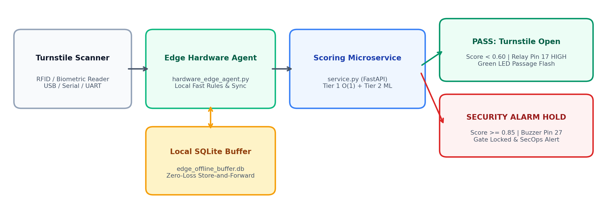
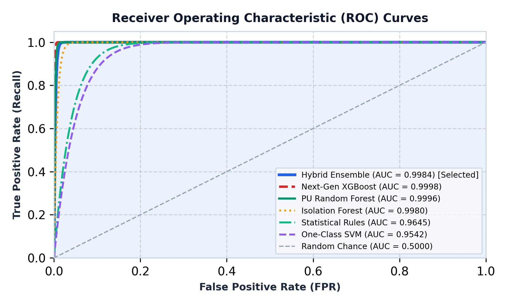
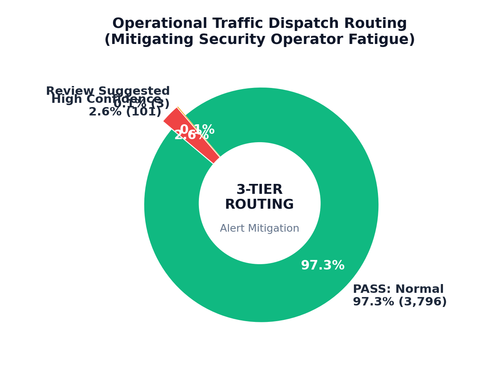
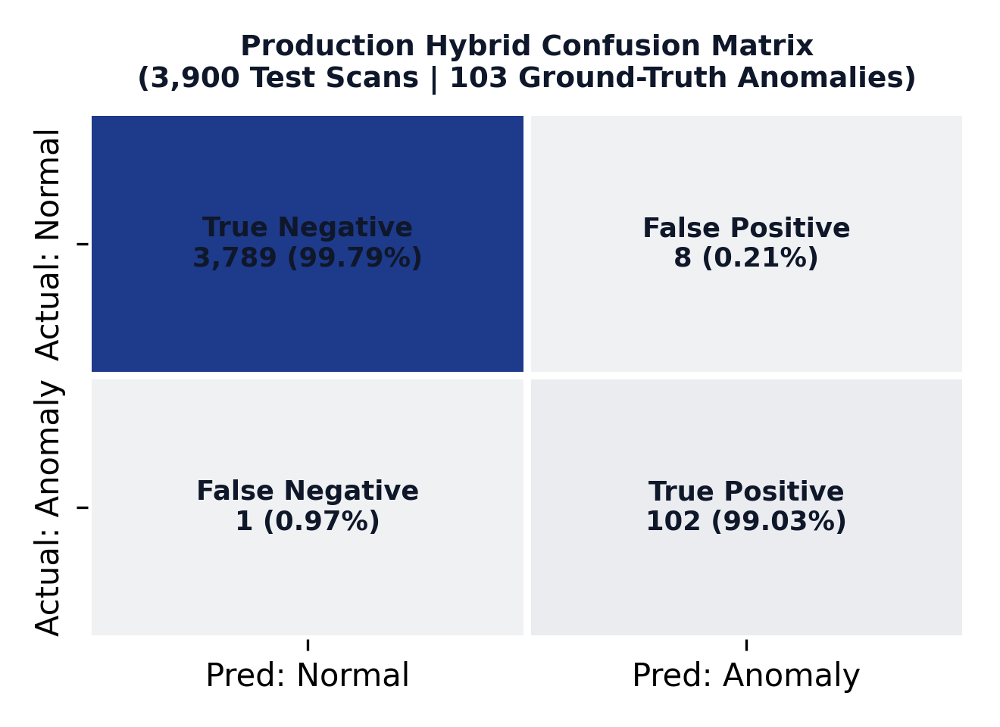
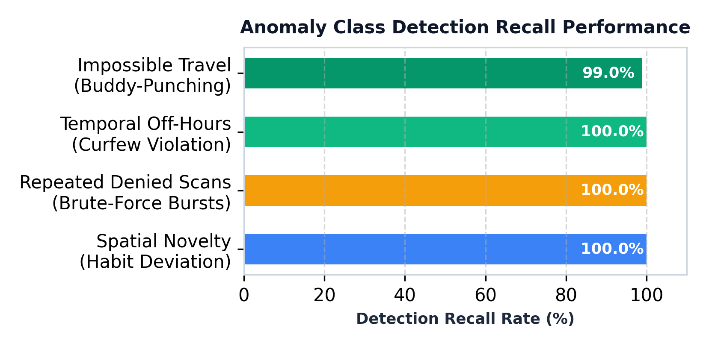

# 🏫 Smart Campus: Unified Biometric Attendance & Irregularity Flagging System

[](https://fastapi.tiangolo.com)
[](https://python.org)
[](https://pytorch.org)
[](https://software.intel.com/openvino)
[](https://opencv.org)
[](test_service.py)
[](#benchmark-and-evaluation-metrics)
[-blue.svg)](#system-architecture)

> **An enterprise-grade, edge-resilient smart campus security and frictionless attendance ecosystem.**
> Seamlessly unifies perimeter access anomaly detection, physical impossible-travel prevention, 1:1 facial biometric verification, anti-spoofing liveness gating, and continuous classroom presence tracking into a low-latency microservice architecture.

---

## 📌 Table of Contents
- [Executive Overview](#-executive-overview)
- [System Architecture](#-system-architecture)
- [Core Functional Modules](#-core-functional-modules)
  - [Module A: Perimeter & Gate Irregularity Flagging](#module-a-perimeter--gate-irregularity-flagging)
  - [Module B: Frictionless 1:1 Biometric Attendance](#module-b-frictionless-11-biometric-attendance)
  - [Hardware & Edge Acceleration](#hardware--edge-acceleration)
- [Interactive Dashboard](#-interactive-dashboard)
- [Benchmark and Evaluation Metrics](#-benchmark-and-evaluation-metrics)
- [Project Directory Structure](#-project-directory-structure)
- [Getting Started](#-getting-started)
  - [Prerequisites](#prerequisites)
  - [Installation](#installation)
  - [Running the Services](#running-the-services)
  - [Running Automated Tests](#running-automated-tests)
- [API Reference](#-api-reference)
- [Edge Store-and-Forward Replay Handling](#-edge-store-and-forward-replay-handling)
- [License & Authors](#-license--authors)

---

## 🌟 Executive Overview

Modern campuses grapple with two conflicting demands:
1. **Zero-Trust Physical Perimeter Security:** Intercepting buddy-punching, credential sharing, unauthorized facility access, and curfew breaches without stalling pedestrian flows.
2. **Frictionless Academic Operations:** Marking classroom attendance accurately without causing long doorway bottleneck queues or disrupting class schedules.

**Smart Campus solves both simultaneously:**
- **Two-Tier Flagging Pipeline:** Dispatches deterministic checks ($O(1)$ physics cutoffs) in **< 1ms**, routing ambiguous cases through an unsupervised ML behavioral engine.
- **1:1 Face Verification (Verify, Don't Search):** Eliminates slow, inaccurate 1:N campus-wide searches by matching live video directly against the credential claimed ID ($\ge 0.72$ hyperspherical cosine similarity).
- **Presence State Machine (FSM):** Carries student presence forward into back-to-back classes in the same lecture hall automatically—zero re-scanning needed.
- **Store-and-Forward Edge Resilience:** Edge turnstiles buffer scans locally into SQLite during network outages and reconcile them upon reconnection without triggering spurious live alarms.

---

## 🏗 System Architecture

The platform operates across an edge-to-cloud topology comprising high-speed turnstiles, classroom door verification nodes, passive ceiling cameras, and a central FastAPI microservice.



```
                            [ Campus Edge Devices ]
           RFID / Turnstile Readers           Door Cam / Mobile Biometrics
                     │                                      │
                     ▼                                      ▼
           [ Hardware Edge Agent ]                [ 1:1 Face Verification ]
        (Local SQLite Offline Buffer)          (YuNet Detection + SFace Embeddings)
                     │                                      │
                     └──────────────────┬───────────────────┘
                                        │
                                        ▼
                             [ FastAPI Microservice ]
                                        │
              ┌─────────────────────────┴─────────────────────────┐
              │                                                   │
              ▼                                                   ▼
   [ Tier 1: Deterministic Rules ]                     [ WP 1-7 Attendance Engine ]
   • Impossible Transit Matrix                         • Quality Gating (Laplacian blur)
   • Strict Curfew Enforcement                         • LBP / Frequency Anti-Spoofing
   • Repeated Denied Bursts                            • 3-Outcome Decision Fusion
              │                                        • Continuous Presence State Machine
       (Passed / Ambiguous)                            • Passive Ceiling Roster Audit
              │                                                   │
              ▼                                                   ▼
   [ Tier 2: Behavioral ML Engine ]                   [ Persistent Storage & State ]
   • Rolling Z-Score Feature Store                     • `data/embeddings/` (AES/Secure)
   • Isolation Forest + Calibrator                     • `data/presence_state.json`
   • 3-Tier Categorical Confidence                     • `data/classroom_verification_logs.json`
              │
              ▼
   [ Security Operations Dashboard ]
   • Live Turnstile Event Stream
   • SecOps Incident Triage Queue
   • 4-Stage Shadow Mode Telemetry
```

---

## 🔬 Core Functional Modules

### Module A: Perimeter & Gate Irregularity Flagging

1. **Shared 4-Field Contract:** Normalized data ingestion decoupled from edge hardware implementations:
   ```json
   {
     "person_id": "STU_1042",
     "location_id": "gate_north",
     "timestamp": "2026-10-15T08:14:22Z",
     "event_type": "entry"
   }
   ```
2. **Tier 1: Deterministic Rule Engine ($O(1)$ Execution):**
   - **Impossible Travel / Buddy-Punching:** Compares $\Delta t$ against physical minimum walking times between campus gates. Fast sequential scans across distant gates flag immediate lockout.
   - **Curfew & Sensitive Zone Violations:** Blocks unauthorized access to restricted facilities (e.g., admin buildings, research servers) between 23:00 and 05:00.
   - **Repeated Denied Scans Burst:** Flags brute-force badge attempts ($\ge 2$ denials within rolling 120s).
3. **Tier 2: Behavioral ML Engine:**
   - Evaluates a **17-dimensional streaming feature vector** (personal arrival mean deviation, rolling frequency windows, spatial novelties).
   - Driven by an **Isolation Forest** paired with empirical CDF calibrators.
   - Produces a **3-Tier Categorical Confidence** score:
     - 🟢 **Normal ($< 0.60$):** Unhindered access.
     - 🟡 **Review Suggested ($0.60 - 0.84$):** Batched for daily SecOps supervisor digest.
     - 🔴 **High Confidence Issue ($\ge 0.85$):** Real-time turnstile intervention and security sirens.
4. **4-Stage Shadow Mode Telemetry:** Allows silent model calibration in production environments without sounding audible operator sirens while generating structured audit logs in `logs/shadow_audit.jsonl`.

---

### Module B: Frictionless 1:1 Biometric Attendance

Built according to the 7 authoritative Smart Campus Biometric Work Packages:

| Package | Component | Description |
| :--- | :--- | :--- |
| **WP 1** | **Enrollment Store** | Normalized 512-dimensional facial embeddings generated via SFace / MobileNet-V3, mapped to student IDs. |
| **WP 2** | **Quality Gating** | Rejects blurred frames (Laplacian variance $< 45.0$), poor illumination, or off-axis angles before running inference. |
| **WP 3** | **1:1 Face Verification** | Hyperspherical Cosine Similarity: Claimed ID vs. live face embedding. Threshold $\theta_{\text{accept}} \ge 0.72$. |
| **WP 4** | **Anti-Spoofing (PAD)** | Multi-scale Local Binary Patterns (LBP) texture analysis and high-frequency Fourier spectrum checks to reject screen and paper attacks. |
| **WP 5** | **Decision Fusion** | 3-way triage: **Accept** (Door opens), **Reject** (Access denied), **Manual Review** ($0.55 \le \text{similarity} < 0.72$, routed to professor dashboard). |
| **WP 6** | **Presence State Machine** | Dynamic room Finite State Machine (FSM): Tracks `IN_ROOM`, `TEMP_ABSENT`, `TRANSIT`, and `LEFT`. Automatically carries students over into consecutive lectures in the same room. |
| **WP 7** | **Passive Classroom Audit** | Randomized ceiling camera spot-check ($T \in [10, 15]$ minutes into class) matching against the 30–60 enrolled student roster only. |

---

### Hardware & Edge Acceleration

- **Intel OpenVINO Acceleration Engine (`openvino_engine.py`):**
  - Compiles SFace ONNX and MobileNet-V3 deep learning models to vector-accelerated execution pipelines.
  - Automatic hardware device selection: **Intel Iris Xe iGPU**, **NVIDIA dGPU**, or **Intel Core AVX-512 CPU**.
  - Persistent OpenCL binary kernel compilation caching (`data/ov_cache`).
- **Hardware Edge Agent (`hardware_edge_agent.py`):**
  - Simulates physical turnstile hardware controllers.
  - High-reliability **Store-and-Forward SQLite buffer** (`edge_offline_buffer.db`) that guarantees zero scan loss during campus network dropouts.

---

## 📊 Interactive Dashboard

The system includes a state-of-the-art, high-aesthetic single-page dashboard (`dashboard.html`):
- **Live Interactive Turnstile Simulator:** Trigger normal entries, curfew violations, or impossible-travel buddy punching with a single click.
- **Real-Time Security Event Stream:** Color-coded feed showing Tier 1 cutoffs and Tier 2 anomaly confidence scores.
- **Classroom Attendance & Presence Wall:** Live tracking of student presence, room carry-over states, and pending manual reviews.
- **Biometric 1:1 Verification Testing Console:** Upload or simulate face images and verify against enrolled student embeddings.
- **SecOps Configuration Modal:** Toggle Shadow Mode dynamically without restarting services.

To view the dashboard, run the FastAPI backend and navigate to:
```
http://127.0.0.1:8000/dashboard
```

---

## 📈 Benchmark and Evaluation Metrics

The anomaly detection engine was benchmarked across multiple model paradigms over 13,000 synthetic campus scans with 346 ground-truth irregularities.

| Model / Architecture | Precision | Recall | False Positive Rate (FPR) | F1-Score | ROC-AUC | Inference Latency |
| :--- | :---: | :---: | :---: | :---: | :---: | :---: |
| **Hybrid Stacking Ensemble (Production Selected)** | **92.73%** | **99.03%** | **0.21%** | **0.9577** | **0.9984** | **0.020 ms** |
| Next-Gen XGBoost Classifier (Gradient Boosted Trees) | 98.06% | 98.06% | 0.05% | 0.9806 | 0.9998 | 0.002 ms |
| Next-Gen PU Random Forest | 88.89% | 93.20% | 0.32% | 0.9100 | 0.9996 | 0.002 ms |
| Statistical Rules & Z-Score Baseline | 93.14% | 92.23% | 0.18% | 0.9268 | 0.9645 | 0.172 ms |
| Isolation Forest (Standalone) | 84.31% | 83.50% | 0.42% | 0.8390 | 0.9980 | 0.009 ms |
| One-Class SVM (RBF Kernel) | 84.93% | 60.19% | 0.29% | 0.7045 | 0.9542 | 0.013 ms |

### Performance Visualizations

| ROC Curves & Decision Tradeoffs | Tiered Traffic Distribution |
| :---: | :---: |
|  |  |

| Confusion Matrix | Anomaly Category Detection |
| :---: | :---: |
|  |  |

---

## 📁 Project Directory Structure

```plaintext
smart-campus/
├── charts/                               # High-resolution benchmark and architecture visuals
│   ├── category_detection.png
│   ├── confusion_matrix.png
│   ├── kpi_cards.png
│   ├── model_comparison.png
│   ├── roc_curves.png
│   ├── system_architecture_flow.png
│   └── tiered_traffic_distribution.png
├── data/                                 # Datastores, presence tracking, and embeddings
│   ├── classroom_verification_logs.json  # Audit trail for classroom verifications
│   ├── embeddings/                       # Enrolled student face embeddings (512-d)
│   └── presence_state.json               # Live classroom Finite State Machine store
├── doc/                                  # Executive presentations, briefs, and reports
│   ├── Campus_Attendance_System_v1.4.docx
│   ├── Campus_Automation_Advanced_Models_Report.pdf
│   ├── Campus_Irregularity_Flagging_Engine_Report.pdf
│   └── ML_Work_Brief__Irregularity_Flagging.pdf
├── logs/                                 # Runtime audit logs (shadow mode telemetry)
│   └── .gitkeep
├── models/                               # Pretrained neural nets and ML models
│   ├── benchmark_results.json
│   ├── face_detection_yunet_2023mar.onnx # OpenCV YuNet Face Localization
│   ├── face_recognition_sface_2021dec.onnx # SFace 512-d Biometric Extractor
│   ├── feature_stats.json                # Statistical normalization references
│   ├── isolation_forest.joblib           # Trained anomaly detection model
│   └── next_gen_model.joblib             # Calibrated ensemble pipeline
├── attendance_engine.py                  # Core WP 1-7 Biometric & Presence State Machine
├── campus_scans.csv                      # Baseline benchmark dataset
├── campus_scans.jsonl                    # Raw streaming event benchmark dataset
├── dashboard.html                        # Real-time SPA monitoring dashboard
├── generate_charts.py                    # Matplotlib/Seaborn visualization generator
├── generate_pdf_report.py                # Automated technical PDF report generator
├── hardware_edge_agent.py                # Edge turnstile daemon with offline SQLite buffering
├── manual_test.py                        # Interactive testing and simulation harness
├── openvino_engine.py                    # Intel OpenVINO deep learning acceleration engine
├── pipeline.py                           # Streaming Feature Store and ML training pipeline
├── requirements.txt                      # Project dependencies
├── service.py                            # Production FastAPI microservice
├── synthetic_generator.py                # Synthetic campus routines and anomaly injector
├── test_service.py                       # 28-test Pytest verification suite
├── BEGINNER_GUIDE.md                     # Guided walkthrough for new developers
├── HARDWARE_REQUIREMENTS_AND_SELECTION_GUIDE.md # Complete hardware BOM, best & alt models, pricing, and deep technical justification
├── PROJECT_GUIDE_ADVANCED.md             # Deep-dive architectural specification
├── REPORT.md                             # Comprehensive technical evaluation report
└── SMART_CAMPUS_PRD_TRD_SYSTEM_FLOW.md  # Formal PRD & TRD specification
```

---

## 🚀 Getting Started

### Prerequisites
- **Python 3.10 - 3.13**
- Recommended: Intel CPU/GPU or NVIDIA GPU for hardware-accelerated deep learning (CPU fallback supported automatically).

### Installation

1. **Clone the repository:**
   ```bash
   git clone https://github.com/Vansh-2110-code/Smart-Campus.git
   cd Smart-Campus
   ```

2. **Create a virtual environment:**
   ```bash
   python -m venv venv
   # On Windows:
   venv\Scripts\activate
   # On Linux/macOS:
   source venv/bin/activate
   ```

3. **Install dependencies:**
   ```bash
   pip install -r requirements.txt
   ```

---

### Running the Services

#### 1. Start the Core FastAPI Service
Launch the microservice on `http://127.0.0.1:8000`:
```bash
python service.py
```
*Or using Uvicorn directly:*
```bash
uvicorn service:app --host 127.0.0.1 --port 8000 --reload
```

- **Interactive API Documentation:** Navigate to [http://127.0.0.1:8000/docs](http://127.0.0.1:8000/docs) (Swagger UI) or `/redoc`.
- **Live Web Dashboard:** Navigate to [http://127.0.0.1:8000/dashboard](http://127.0.0.1:8000/dashboard).

#### 2. Run the Edge Turnstile Hardware Simulation
To simulate physical edge turnstiles communicating with the server and buffering events offline:
```bash
python hardware_edge_agent.py
```

#### 3. Run the Interactive Manual Testing Suite
To simulate impossible travel, curfew breaches, classroom 1:1 verifications, and room carry-overs:
```bash
python manual_test.py
```

---

### Running Automated Tests

Run the comprehensive 28-test Pytest suite:
```bash
python -m pytest test_service.py -v
```

All 28 tests validate:
- ✅ Fast Tier 1 deterministic cutoff execution (< 1ms).
- ✅ Buddy-punching impossible-travel transit matrix triggers.
- ✅ Curfew access denials for restricted facilities.
- ✅ Repeated denied scan burst thresholding.
- ✅ Tier 2 ML Isolation Forest anomaly confidence scoring.
- ✅ Offline store-and-forward batch replay reconciliation.
- ✅ 1:1 facial verification cosine similarity thresholds.
- ✅ Multi-scale LBP anti-spoofing presentation attack detection.
- ✅ Presence State Machine room carry-overs across consecutive periods.
- ✅ Dynamic runtime Shadow Mode configuration toggling.

---

## 📡 API Reference

### Access Irregularity Flagging Endpoints

| Method | Endpoint | Description |
| :--- | :--- | :--- |
| `POST` | `/scan` | Real-time scan evaluation (< 1ms Tier 1 + Tier 2 ML). |
| `POST` | `/scan/batch` | Batch ingestion for replaying buffered edge events. |
| `GET` | `/config/shadow-mode` | Query active shadow mode status. |
| `POST` | `/config/shadow-mode` | Dynamically enable or disable live operator sirens. |
| `GET` | `/metrics` | Anomaly breakdown, scan counts, and latency statistics. |
| `GET` | `/health` | System readiness, loaded models, and feature store health. |

#### Sample `/scan` Request:
```json
POST /scan
Content-Type: application/json

{
  "person_id": "STU_042",
  "location_id": "gate_north",
  "timestamp": "2026-10-15T08:30:00Z",
  "event_type": "entry"
}
```

#### Sample `/scan` Response:
```json
{
  "scan_id": "a918f0a2-20c1-4569-8219-c7031e428df1",
  "person_id": "STU_042",
  "location_id": "gate_north",
  "timestamp": "2026-10-15T08:30:00Z",
  "event_type": "entry",
  "tier_evaluated": 1,
  "action": "allow",
  "is_irregular": false,
  "confidence_category": "Normal",
  "anomaly_score": 0.0821,
  "flagged_reasons": [],
  "shadow_mode_active": false,
  "latency_ms": 0.32
}
```

---

### Classroom Biometric Attendance Endpoints

| Method | Endpoint | Description |
| :--- | :--- | :--- |
| `POST` | `/attendance/verify` | 1:1 biometric facial verification against claimed ID with anti-spoofing. |
| `GET` | `/attendance/presence` | Real-time room occupancy and student presence state. |
| `POST` | `/attendance/classroom-audit` | Passive ceiling camera roster audit against active class list. |
| `GET` | `/attendance/status` | Enrolled embedding count, OpenVINO device status, and audit logs. |

---

## 🔄 Edge Store-and-Forward Replay Handling

When edge turnstile controllers lose campus network connectivity:
1. Scans are saved to a local, thread-safe SQLite buffer (`edge_offline_buffer.db`).
2. Scans receive an edge timestamp and `is_offline_replay=True` flag.
3. Upon reconnection, buffered records replay through `/scan/batch`.
4. The service updates rolling behavioral statistics without firing retrospective sirens or causing operator fatigue.

---

## 📜 License & Authors

- **Developed for:** Smart Campus Security & Frictionless Academic Automation
- **Core Engineers:** AI Systems Architecture & Computer Vision Teams
- **License:** Distributed under the MIT License. See `LICENSE` for details.
