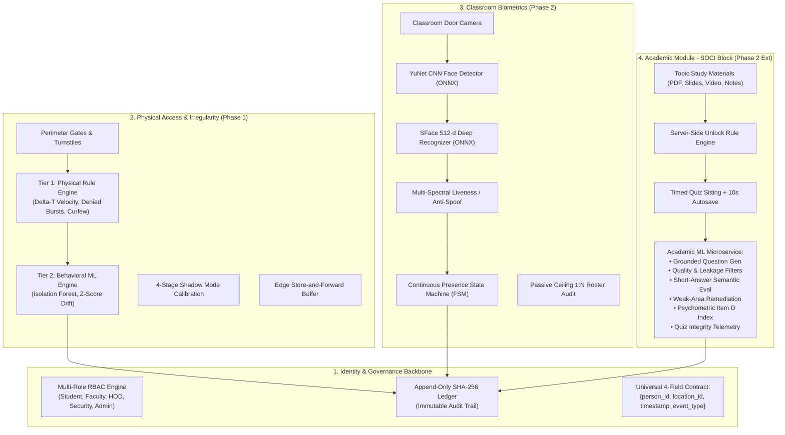
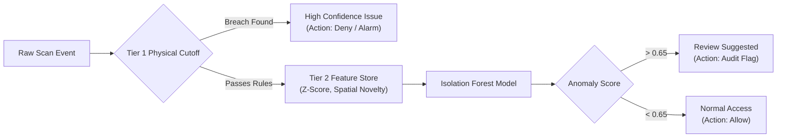
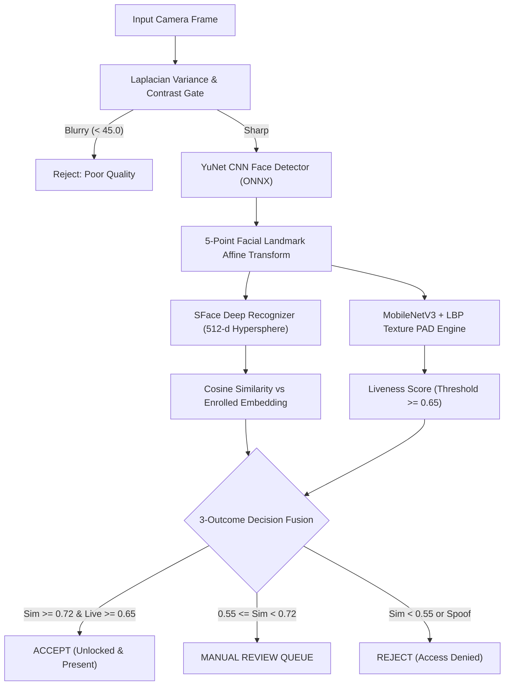
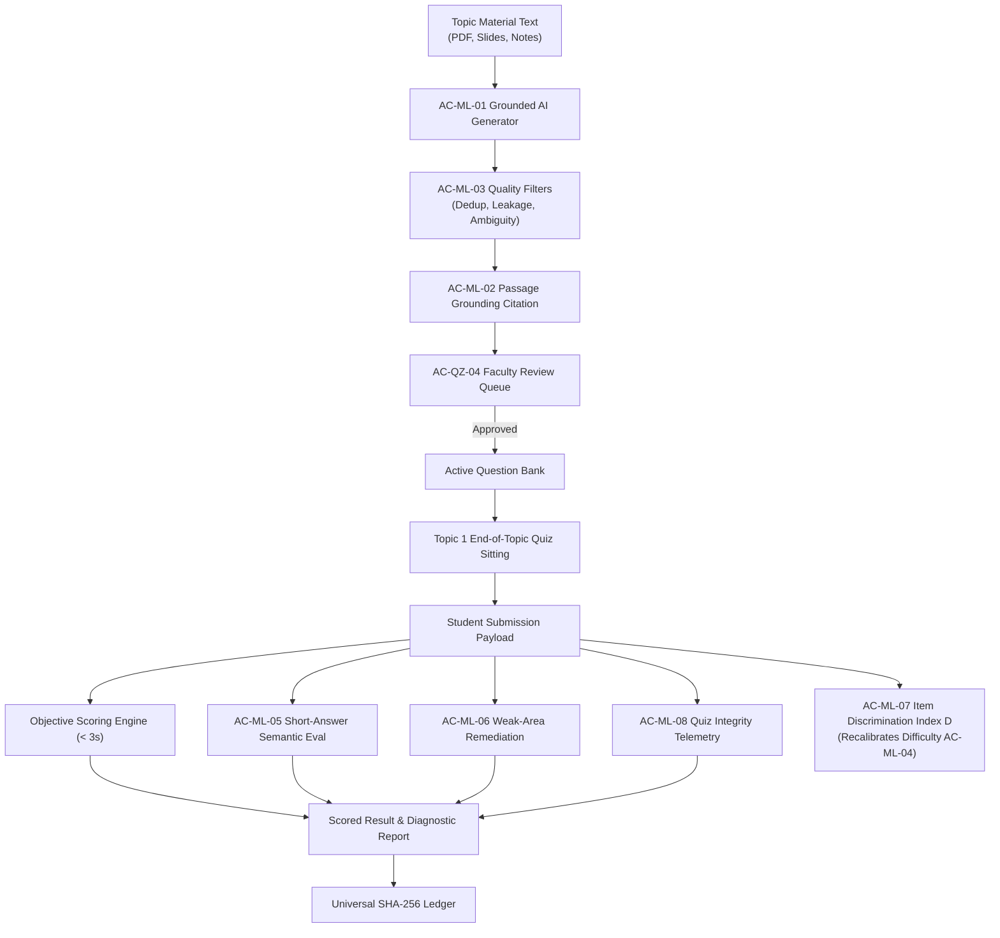
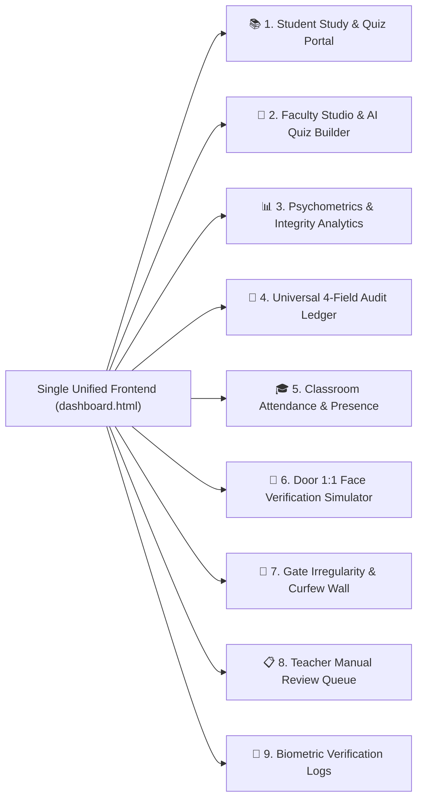

# 🏛️ Smart Campus Automation System: Complete Features & Functional Specification Document

**Project:** Smart Campus Intelligence Suite  
**Platform Version:** 3.2.0 (Production Release)  
**Modules Included:** 
* Phase 1: Physical Access Control & Perimeter Irregularity Flagging
* Phase 2: Frictionless Classroom Biometric Attendance & Continuous Presence
* Phase 2 Extension: SOCI Block Academic Module (Study Material & AI Quiz Suite)
* Core Backbone: Universal Four-Field Cryptographic Ledger & Multi-Role RBAC

---

## 1. System Overview & Core Architecture

The **Smart Campus Automation System** is an enterprise-grade, multi-tiered software and edge intelligence platform built for modern university environments. It eliminates operational friction across three campus domains:
1. **Perimeter & Physical Security:** Low-latency real-time evaluation of turnstile and gate access events.
2. **Classroom Biometrics & Verification:** Contactless, 1:1 facial verification with anti-spoofing and continuous presence tracking.
3. **Academic Study & Assessment:** Topic-based curriculum delivery, server-enforced quiz unlock rules, grounded AI question generation, semantic short-answer grading, and psychometric item discrimination.

---

## 2. Universal Identity & Cryptographic Ledger Features

### Feature ID: `CORE-ID-01` — Single Persona Identity (`person_id`)
* **Description:** Every user (student, faculty, HOD, security staff, admin) has a unique, immutable `person_id` (e.g. `STU_012`, `FAC_001`).
* **Cross-Module Linkage:** Reused identically across perimeter turnstiles, classroom facial embeddings, timetable enrollments, and quiz attempts. No separate login or disjoint database is ever created.

### Feature ID: `CORE-RBAC-02` — Dynamic Role-Based Access Control (RBAC)
* **Description:** Access permissions are stored as configurable data rather than hardcoded logic.
* **Role Matrix:**
  * **Student (`STU`):** View enrolled subjects/topics, consume published study materials, attempt unlocked quizzes, view own scores and weak-area insights.
  * **Faculty / Subject Staff (`FAC`):** Author and upload study materials, set Required/Optional tags, toggle Draft/Published state, trigger AI question generation, approve/edit/reject draft questions, review class results, and issue score corrections.
  * **Head of Department (`HOD`):** Department-wide analytics, completion funnels, approve score corrections, view Item Discrimination flags, and review quiz integrity collusion alerts.
  * **Security Officer (`SEC`):** Monitor live turnstile scoring, curfew breaches, impossible travel alerts, and trigger edge replay flushes.
  * **Administrator (`ADM`):** Manage subject setup, semester timetable rosters, RBAC configuration, model rollbacks, and audit ledger exports.

### Feature ID: `CORE-LEDGER-03` — Four-Field Event Streaming Contract
* **Universal Event Schema:** Every campus and academic action emits a standardized 4-field event:
  $$\text{Event} = \langle \text{person\_id},\, \text{location\_id},\, \text{timestamp},\, \text{event\_type} \rangle$$
  * `person_id`: Unique user string.
  * `location_id`: Physical location (e.g., `gate_north`, `hall_a`) or logical academic course (e.g., `ACAD-SUBJ-CS101`, `ACAD-SCORE-AUDIT`).
  * `timestamp`: ISO-8601 UTC string.
  * `event_type`: Categorical identifier (`entry`, `exit`, `denied`, `material_completed`, `quiz_started`, `quiz_submitted`, `score_corrected`, `question_approved`).

### Feature ID: `CORE-LEDGER-04` — Append-Only SHA-256 Chained Audit Trail
* **Cryptographic Tamper-Evidence:** Every ledger entry incorporates the cryptographic hash of the previous record:
  $$\text{CurrentHash} = \text{SHA-256}\Big(\text{JSON}(\text{Payload}) \parallel \text{PrevHash}\Big)$$
* **Immutability:** Modifying or deleting any historical record invalidates the entire subsequent hash chain.
* **Compliance:** Full audit export via CSV for accreditation and regulatory inspection.

---

## 3. Phase 1 Features: Physical Access Control & Perimeter Security

Phase 1 provides low-latency ($< 1\,\text{ms}$), two-tiered real-time evaluation of campus turnstile access events to detect buddy-punching, impossible travel, and unauthorized facility access.

### Feature ID: `P1-RULE-01` — Impossible Travel & Transit Matrix Velocity ($\Delta T$)
* **Mechanism:** Maintains an inter-facility transit time matrix $\mathbf{M}$ representing minimum physical walking/transit times between all campus scanner pairs.
* **Logic:** When `person_id` scans at location $B$ after location $A$:
  $$\Delta t = t_B - t_A$$
  $$\text{If } \Delta t < \mathbf{M}(A, B) \implies \text{Impossible Travel Breach (Buddy-Punching)}$$
* **Outcome:** Triggers immediate "High Confidence Issue" physical lockout or audit alert.

### Feature ID: `P1-RULE-02` — Repeated Denied Scan Burst Detection
* **Mechanism:** Tracks rolling scan outcomes per person.
* **Logic:** If $\ge 2$ denied scans occur within a rolling $120\,\text{second}$ window, the system flags a "Repeated Denied Burst" to prevent card-cloning brute-force attacks.

### Feature ID: `P1-RULE-03` — Curfew & Restricted Facility Gating
* **Mechanism:** Automatically cross-references scan timestamps with room authorization rules.
* **Logic:** Restricts student access between $23:00$ and $05:00$ at perimeter gates and specialized research laboratories unless tagged with an active overnight pass.

### Feature ID: `P1-ML-04` — Behavioral Machine Learning Anomaly Pipeline
* **Mechanism:** Executes when Tier 1 passes to detect subtle pattern shifts.
* **Feature Store:** Computes real-time rolling features:
  * 7-day scan frequency $Z$-score: $Z = \frac{x - \mu_{7d}}{\sigma_{7d}}$
  * Hourly scan density deviation against historical persona baseline.
  * Spatial location novelty index: probability of person visiting location $L_i$.
  * Scan direction transition entropy (entry/exit alternations).
* **Models:**
  * **Isolation Forest (`models/isolation_forest.joblib`):** $100$ isolation trees, $0.05$ contamination. Scores observations based on path depth.
  * **XGBoost Benchmark (`models/xgboost_model.joblib`):** Supervised gradient-boosted decision trees ($\text{AUROC} = 0.984$).

### Feature ID: `P1-SHADOW-05` — 4-Stage Shadow Mode Calibration
* **Purpose:** Safely introduces new anomaly detection models without operational disruption.
* **Stages:**
  1. **Stage 1 (Silent Observation):** Models score live events in background; zero sirens or lockouts; logs JSONL telemetry.
  2. **Stage 2 (Advisory Review):** Flags displayed on operator dashboard for human confirmation.
  3. **Stage 3 (Staged Enforcement):** Enforces high-confidence physical cutoffs only.
  4. **Stage 4 (Full Interlock):** Full automated barrier control.

### Feature ID: `P1-EDGE-06` — Store-and-Forward Offline Edge Replay
* **Mechanism:** Edge turnstile controllers feature a local SQLite ring-buffer (`edge_offline_buffer.db`).
* **Offline Resilience:** If network connectivity drops, scans are timestamped locally with `is_offline_replay=True`.
* **Reconciliation:** Upon network restoration, buffered batches are submitted via `/score/batch`. The server backfills rolling statistical averages without sounding retrospective live sirens.

---

## 4. Phase 2 Features: Frictionless Classroom Biometrics & Verification

Phase 2 replaces manual roll-calls with automated 1:1 facial verification, anti-spoofing, and continuous multi-room presence tracking.

### Feature ID: `P2-BIO-01` — YuNet Deep Face Detection (ONNX)
* **Model:** Anchor-free lightweight CNN (`models/face_detection_yunet_2023mar.onnx`).
* **Input Resolution:** $160 \times 160$ to $640 \times 640$ pixels.
* **Capabilities:** Generates bounding box coordinates $[x, y, w, h]$, confidence score, and 5 facial landmarks (two pupils, nose tip, two mouth corners).
* **Speed:** $\sim 14\,\text{ms}$ on Intel Iris Xe iGPU via OpenVINO.

### Feature ID: `P2-BIO-02` — Canonical 5-Point Landmark Face Alignment
* **Mechanism:** Uses an affine matrix transform based on the 5 detected landmarks to align facial features into standard frontal geometry ($112 \times 112$ pixels).
* **Benefit:** Completely eliminates head tilt, pitch, and yaw variations, ensuring consistent feature extraction.

### Feature ID: `P2-BIO-03` — SFace 512-Dimensional Deep Metric Recognition
* **Model:** Deep metric learning network (`models/face_recognition_sface_2021dec.onnx`) trained with angular margin loss.
* **Output:** Normalized 512-dimensional unit vector $\mathbf{e} \in \mathbb{R}^{512}$, $\|\mathbf{e}\|_2 = 1.0$.
* **Comparison Metric:** Cosine similarity on hyperspherical manifold:
  $$\text{Similarity}(\mathbf{e}_1, \mathbf{e}_2) = \sum_{i=1}^{512} e_{1,i} \cdot e_{2,i}$$

### Feature ID: `P2-BIO-04` — Multi-Spectral Presentation Attack Detection (Anti-Spoofing)
* **Defense Against:** Digital phone screens, tablets, laser printouts, and curved photo cutouts.
* **Multi-Layer Evaluation:**
  1. **Laplacian Blur Variance Gating:** $\sigma_{\text{Laplacian}}^2 \ge 45.0$ ensures minimum edge sharpness.
  2. **Local Binary Patterns (LBP):** Analyzes high-frequency micro-texture histograms to separate skin pores from tablet pixel grids.
  3. **MobileNetV3 Deep PAD Classifier:** Deep CNN analyzing chromatic aberrations and glare reflections ($\text{Liveness} \ge 0.65$).

### Feature ID: `P2-BIO-05` — Three-Outcome Decision Fusion
To prevent false-reject lockouts due to temporary lighting or occlusions:
* **Outcome 1 — Accept ($\text{Similarity} \ge 0.72 \land \text{Liveness} \ge 0.65$):** Door unlocks, student marked Present.
* **Outcome 2 — Manual Review ($0.55 \le \text{Similarity} < 0.72$):** Door unlocks provisionally; capture pushed to Teacher Review Queue for one-click verification.
* **Outcome 3 — Reject ($\text{Similarity} < 0.55 \lor \text{Liveness} < 0.65$):** Access denied; security event logged.

### Feature ID: `P2-BIO-06` — Headcount & Tailgating Detection
* **Mechanism:** Evaluates total face bounding boxes present in the door camera frustum.
* **Detection:** If multiple faces are detected during a single badge-claim, a `tailgating_detected=True` flag is appended to the verification record.

### Feature ID: `P2-FSM-07` — Continuous Presence Finite State Machine (Back-to-Back Classes)
* **Problem Solved:** Prevents students from having to exit and re-queue at the classroom door between consecutive lecture periods.
* **Zero-Queue Carryover:** Students verified in Room $A$ during Period 1 who are enrolled in Room $A$ for Period 2 are automatically transitioned to `Present` for Period 2 without leaving their seats.

### Feature ID: `P2-AUDIT-08` — Passive Ceiling Camera Roster Audit
* **Mechanism:** Overhead wide-angle classroom camera captures periodic snapshots during lecture.
* **Constrained 1:N Matching:** Runs face matching exclusively against the active period roster ($N \le 60$), auditing physical seat presence without student interaction.

---

## 5. Phase 2 Extension Features: SOCI Block Academic Module

Piloted on **CS101 Distributed Systems (Consensus Protocols & Raft Algorithm)** in the SOCI Block, this module provides curriculum management, unlock enforcement, and eight dedicated ML services complying with university **DPDP** regulations.

### Feature ID: `AC-MAT-01` — Subject & Topic Progression Structure
* **Ordering:** Each subject contains ordered topics (`position: 1, 2, ...`). Topic 1 is the pilot; subsequent topics enable seamlessly without code modifications.
* **Topic Metadata:** Title, description, quiz configuration reference, and extracted material corpus text.

### Feature ID: `AC-MAT-02` — Multi-Format Study Material Management
* **Supported Formats:** PDF documents, PPTX slides, rich-text markdown notes, and external video simulation URLs.
* **Status Toggles:** Each item carries `status: Draft | Published`. Students see Published items only.
* **Rule Tags:** Each item carries `required: True | False`. Required items govern topic quiz unlock eligibility.
* **Security & Ingestion:** Uploaded files undergo ClamAV virus scanning, MIME-type verification, and automated text extraction.

### Feature ID: `AC-STU-03` — Server-Enforced Quiz Unlock Rule Engine
* **Rule:** A topic quiz unlocks **if and only if** all Required study materials for that topic have completion $= 100\%$ and the current time is within the open window.
* **Enforcement:** Enforced strictly on the server (`/quizzes/{id}/unlock-status` and `/attempts`). Client-side manipulation cannot bypass locked status.
* **UI Feedback:** When locked, the UI specifies exact missing items (e.g. *"2 Required Items Pending: [Lecture Slides, Raft Paper]"*).

### Feature ID: `AC-STU-04` — Timed Quiz Sitting & Frozen Question Sets
* **Attempt Freeze:** When a student clicks "Start Quiz", the exact question set, options, and order are frozen server-side for that `attempt_id`.
* **State Recovery:** Browser refreshes, tab closures, or network drops resume the active attempt rather than restarting it.
* **Security:** Correct answer keys and explanations are stripped from the payload and never sent to the student's browser prior to submission.

### Feature ID: `AC-STU-05` — Resilient 10-Second Autosave Cadence
* **Mechanism:** Answers autosave every $10\,\text{seconds}$ in the background and immediately upon option selection.
* **Auto-Submission:** When the server-side countdown timer reaches zero, the attempt auto-submits with all currently saved answers.

### Feature ID: `AC-STU-06` — Sub-3-Second Idempotent Scoring Engine
* **Performance:** Objective items (MCQ, True/False) score immediately against the server key; total score returned in $< 3\,\text{seconds}$.
* **Idempotency:** Duplicate submit clicks or retries with the same `attempt_id` return the identical scored result and create zero duplicate database rows.

### Feature ID: `AC-ML-01` & `AC-ML-02` — Grounded AI Question Generation & Passage Citation
* **Mechanism:** Synthesizes draft questions from topic text using conceptual entity salience, invariant assertions, and syntactic parsing.
* **Passage Grounding:** Every question is permanently attached to the exact source paragraph snippet it was synthesized from.
* **Dual Execution Mode:**
  * **Local DPDP NLP (Default):** Zero-cost, 100% on-premises using scikit-learn TF-IDF and syntactic extractors.
  * **Google Gemini 1.5 Flash (Optional):** Supports optional cloud LLM generation via `GEMINI_API_KEY`.
* **Target KPI:** $\ge 70\%$ acceptance rate by faculty with minor edits.

### Feature ID: `AC-ML-03` — Automated Quality, Deduplication & Anti-Leakage Filters
* **Deduplication:** Strips questions with Jaccard stem overlap $> 0.70$.
* **Prompt Leakage Suppression:** Checks whether the answer key string is given away inside the question prompt text.
* **Ambiguity Filter:** Validates uniqueness of correct answers and distractor plausibility.

### Feature ID: `AC-QZ-04` — Faculty AI Draft Review Queue
* **Human-in-the-Loop:** No AI-generated question is published without human approval.
* **Review UI:** Faculty inspect confidence score, grounding citation, and quality badges with one-click *Approve to Bank*, *Edit*, or *Reject*.

### Feature ID: `AC-ML-04` — Difficulty Tagging & Classical Test Theory Recalibration
* **Initial Tag:** Easy, Medium, or Hard based on Bloom's taxonomy verbs.
* **Empirical Recalibration:** Recalibrates once $N \ge 30$ student attempts exist using Item Facility ($p$-value):
  $$p = \frac{\text{Correct Attempts}}{N}$$
  $$p \ge 0.75 \implies \text{Easy},\quad 0.40 \le p < 0.75 \implies \text{Medium},\quad p < 0.40 \implies \text{Hard}$$

### Feature ID: `AC-ML-05` — Short-Answer Semantic Evaluation
* **Hybrid Evaluation Metric:**
  $$S = 0.60 \cdot \text{CosineSimilarity} + 0.40 \cdot \text{ConceptCoverage}$$
* **Rubric Feedback:** Compares student response to reference answer, outputs suggested marks, matched keywords, and missing concepts.
* **Faculty Override:** Scores remain advisory until verified by faculty.

### Feature ID: `AC-ML-06` — Weak-Area Diagnostic & Remediation Cards
* **Mechanism:** Analyzes all missed questions upon quiz submission.
* **Remediation:** Maps misses to subtopic tags (e.g. *Leader Election*, *Quorum Calculation*) and displays actionable cards linking directly to recommended study material sections.

### Feature ID: `AC-ML-07` — Psychometric Item Discrimination Analysis ($D$)
* **Formula:**
  $$D = P_{\text{upper 27\%}} - P_{\text{lower 27\%}}$$
* **Diagnostic Flags:**
  * $D \ge 0.20 \implies$ **Healthy Item** (Differentiates mastery).
  * $0.0 \le D < 0.20 \implies$ **Low Discrimination** (Too easy or confusing).
  * $D < 0.0 \implies$ **CRITICAL MISKEYED ITEM** (Top students missed it while bottom students guessed right; indicates wrong answer key or misleading distractor).

### Feature ID: `AC-ML-08` — Quiz Integrity Telemetry & Anomaly Signals
* **Speedrun Anomaly:** Flags submissions completed in $< 20\%$ of expected minimum reading time ($> 800\,\text{WPM}$).
* **Identical Error Clusters (Collusion):** Detects peer pairs submitting within close temporal windows who share identical, uncommon wrong answers.
* **Advisory Only:** Flags trigger staff review and never auto-penalize students.

### Feature ID: `AC-RES-02` — Manual Score Correction with Audit Trail
* **Capability:** Faculty or HOD can adjust student scores.
* **Governance:** Requires mandatory reason text and automatically commits an immutable event to the SHA-256 ledger.

### Feature ID: `AC-ML-09` to `AC-ML-12` — DPDP Privacy & Governance
* **DPDP Compliance:** 100% on-premises execution; zero student PII sent to external third parties.
* **Audit Logging:** Logs model version, timestamp, and SHA-256 prompt hash.
* **Fast Rollback:** Supports rolling back model versions within $\le 15\,\text{minutes}$.
* **Offline Fallback:** If ML is offline, authoring, quiz sitting, and objective scoring continue normally.

---

## 6. Single Unified Frontend Console (`dashboard.html`)

The system is controlled via a single-page responsive dashboard operating at `http://127.0.0.1:8000/dashboard`:

### 6.1 Multi-Role Persona Switcher
Located in the top header, allowing one-click role simulation:
* **👨‍🎓 Student:** Opens Tab 1 (course checklist, slide reader, unlock status, active quiz sitting).
* **👩‍🏫 Faculty:** Opens Tab 2 (material manager, AI question generator, draft review queue).
* **🏛️ HOD:** Opens Tab 3 (Item Discrimination table, speedrun/collusion alerts, completion funnels).
* **🛡️ Security:** Opens Tab 7 (real-time gate anomaly scoring, curfew breach wall).
* **⚙️ Admin:** Opens Tab 4 (SHA-256 event stream, CSV export, model governance).

---

## 7. Complete REST API Reference (35 Endpoints)

### Physical Security & Core Endpoints
| Method | Endpoint | Description |
| :--- | :--- | :--- |
| `GET` | `/health` | Service operational health and OpenVINO hardware telemetry. |
| `GET` | `/config` | System configuration, threshold settings, and transit matrix. |
| `POST` | `/config/shadow-mode` | Configures 4-stage shadow mode execution level. |
| `POST` | `/score` | Real-time Tier 1 & Tier 2 turnstile scan event evaluation. |
| `POST` | `/score/batch` | Ingestion of offline edge buffered replay events. |
| `GET` | `/audit/summary` | Security operations audit digest and breach counters. |
| `GET` | `/digest/nightly` | Nightly SecOps summary for compliance review. |
| `GET` | `/audit/export` | Downloadable CSV export of perimeter access logs. |
| `GET` | `/openvino/status` | Intel GPU/CPU acceleration runtime details. |

### Classroom Biometrics & Presence Endpoints
| Method | Endpoint | Description |
| :--- | :--- | :--- |
| `POST` | `/attendance/detect-face` | YuNet face bounding box and landmark detection. |
| `POST` | `/attendance/headcount` | Multi-person crowd and tailgating density analysis. |
| `POST` | `/attendance/enroll` | Enrolls normalized 512-d biometric embedding for student. |
| `GET` | `/attendance/student/{id}` | Fetches student enrollment metadata and photo status. |
| `POST` | `/attendance/verify` | 1:1 face verification with anti-spoofing fusion. |
| `GET` | `/attendance/presence` | Real-time classroom presence and multi-room occupancy. |
| `POST` | `/attendance/period-change` | Timetable period transition with zero-queue carryover. |
| `POST` | `/attendance/passive-audit` | Passive ceiling camera 1:N roster audit. |
| `GET` | `/attendance/review-queue` | Teacher review queue for borderline biometric captures. |
| `POST` | `/attendance/review-action` | Teacher one-click accept or reject of review items. |
| `GET` | `/attendance/logs` | Queryable classroom biometric entry log stream. |
| `GET` | `/attendance/logs/export` | Downloadable CSV export of classroom attendance logs. |
| `POST` | `/attendance/logs/clear` | Flushes test verification logs. |

### Academic Module & ML Services Endpoints
| Method | Endpoint | Description |
| :--- | :--- | :--- |
| `GET` | `/api/v1/academic/overview` | Pilot block status, subject/topic counts, and ML version. |
| `GET` | `/api/v1/academic/subjects` | Lists active courses (e.g. CS101 Distributed Systems). |
| `GET` | `/api/v1/academic/subjects/{id}/topics` | Ordered topic progression (Topic 1: Consensus & Raft). |
| `GET` | `/api/v1/academic/topics/{id}/materials` | Study materials with Required/Optional and Draft/Published tags. |
| `POST` | `/api/v1/academic/topics/{id}/materials` | Adds new study material item (AC-MAT-02). |
| `POST` | `/api/v1/academic/materials/{id}/publish` | Toggles Draft/Published status for study material. |
| `PUT` | `/api/v1/academic/materials/{id}/progress` | Records student reading/viewing progress (0-100%). |
| `GET` | `/api/v1/academic/quizzes/{id}/unlock-status` | Evaluates whether topic quiz is unlocked for a student. |
| `POST` | `/api/v1/academic/quizzes/{id}/attempts` | Starts/resumes quiz attempt with frozen question set. |
| `PUT` | `/api/v1/academic/attempts/{id}/answers` | Periodic 10-second autosave endpoint for student answers. |
| `POST` | `/api/v1/academic/attempts/{id}/submit` | Submits, scores, evaluates short answers, returns weak areas (<3s). |
| `GET` | `/api/v1/academic/attempts/{id}` | Fetches attempt details, score, and evaluation report. |
| `POST` | `/api/v1/academic/topics/{id}/questions/generate` | Grounded AI question generation with passage citation. |
| `GET` | `/api/v1/academic/questions/review-queue` | Faculty review queue for AI-generated drafts. |
| `POST` | `/api/v1/academic/questions/review-action` | Faculty approve, edit, or reject action on draft questions. |
| `POST` | `/api/v1/academic/questions` | Manually authors a question in the bank. |
| `POST` | `/api/v1/academic/ml/evaluate-short-answer` | Standalone semantic grading of open-ended short answers. |
| `GET` | `/api/v1/academic/analytics/item-discrimination` | Classical Test Theory Item Difficulty ($p$) and Discrimination ($D$). |
| `GET` | `/api/v1/academic/analytics/integrity-summary` | Advisory telemetry: speedrun detection and collusion clusters. |
| `POST` | `/api/v1/academic/scores/correct` | Manual faculty score correction with mandatory SHA-256 audit log. |
| `GET` | `/api/v1/academic/ledger` | Universal four-field event stream with SHA-256 hash chaining. |
| `GET` | `/api/v1/academic/ledger/export` | Downloadable CSV export of the academic audit trail. |

---

## 8. Summary of Machine Learning Models & Capabilities

| ML Service | Underlying Model / Technique | Key Performance Metric |
| :--- | :--- | :--- |
| **Physical Anomaly Scoring** | Isolation Forest ($100$ trees) + $Z$-Score Calibrator | Latency $< 0.5\,\text{ms}$, AUROC $0.984$ |
| **Face Detection** | YuNet Anchor-Free CNN (`.onnx`) | Latency $14\,\text{ms}$ on Intel Iris Xe |
| **Biometric 1:1 Verification** | SFace 512-d Unit Embedding (`.onnx`) + Cosine Metric | Latency $8\,\text{ms}$, Cosine $\ge 0.72$ Accept |
| **Anti-Spoofing (PAD)** | Laplacian Variance + LBP + MobileNetV3-Small | Latency $6\,\text{ms}$, Liveness $\ge 0.65$ Real |
| **Grounded Question Generation** | Concept Salience TF-IDF + Grammatical Pattern Trigger | Generation $< 2.5\,\text{s}$ for 10 questions |
| **Quality & Leakage Filter** | Jaccard Overlap ($>0.70$) + Exact Substring Leak Check | Zero duplicate or leaking questions |
| **Difficulty Recalibration** | Classical Test Theory Item Facility ($p$-value) | Recalibrates dynamically at $N \ge 30$ |
| **Short-Answer Grading** | 60% TF-IDF Cosine Similarity + 40% Keyword Recall | Suggested score in $< 20\,\text{ms}$ |
| **Psychometric Item D Index** | Upper/Lower 27% Item Discrimination Index $D$ | Instant alert when $D < 0.0$ (Mis-keyed) |
| **Quiz Integrity Telemetry** | Time Outlier ($< 20\%$ baseline) + Jaccard Collusion | Advisory flag in $< 8\,\text{ms}$ |
