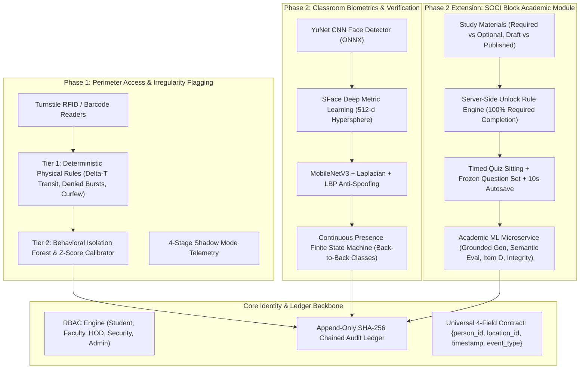
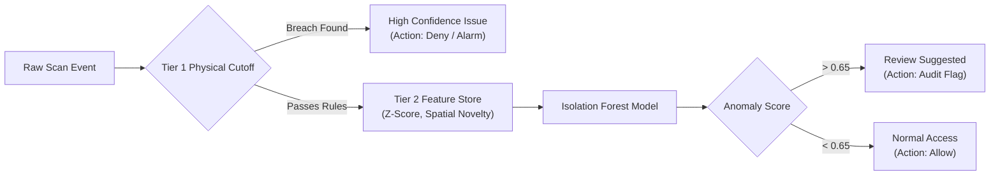
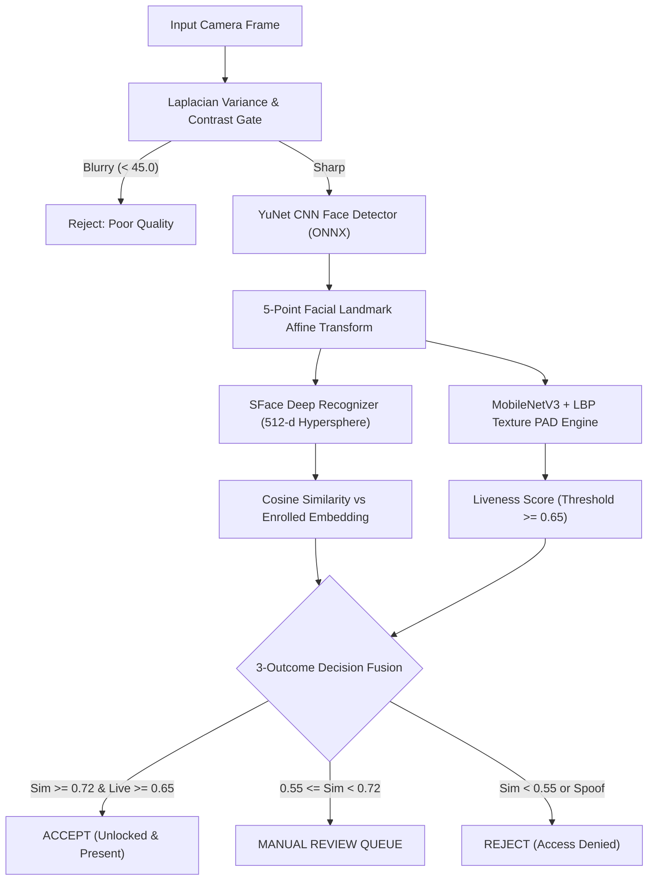
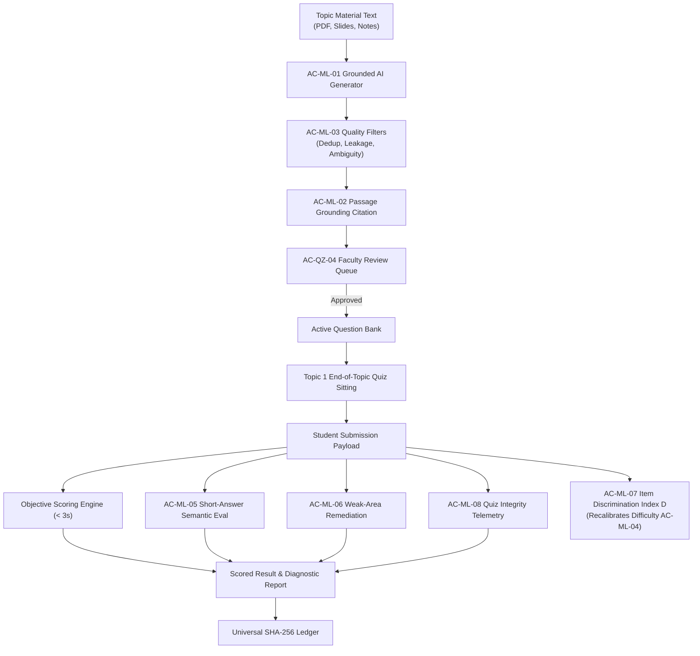
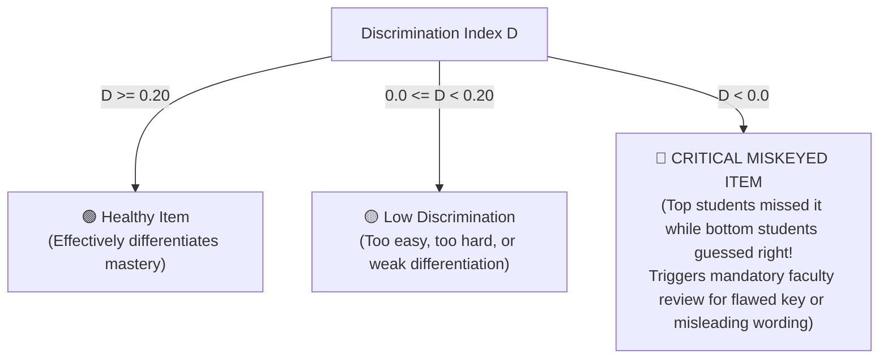
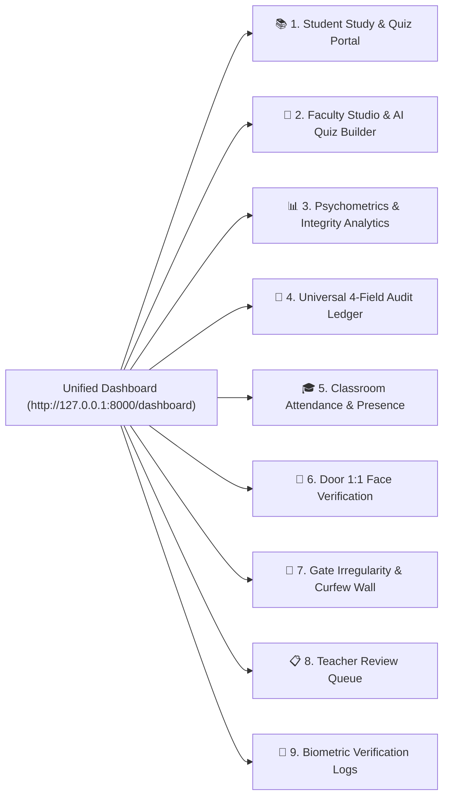

# 🏛️ Smart Campus Automation System: Complete Machine Learning Models, Techniques & Architecture Specification

**Project:** Smart Campus Intelligence Suite  
**Block / Extension:** SOCI Block Academic Extension (Pilot: CS101) + Phase 1 & 2 Core  
**Document Status:** Production Technical Specification  
**Version:** 3.2.0  

---

## 1. Executive Summary & Universal System Architecture

The **Smart Campus Automation System** is an end-to-end, multi-tier artificial intelligence and edge computing platform designed to streamline physical security, biometric classroom attendance, and automated academic learning within university facilities. 

All modules operate over a unified **Identity Backbone (`person_id`)**, a **Role-Based Access Control (RBAC)** matrix, and an **Append-Only Cryptographic Ledger** enforcing the universal four-field event contract:
$$\text{Event} = \langle \text{person\_id},\, \text{location\_id},\, \text{timestamp},\, \text{event\_type} \rangle$$



---

## 2. Phase 1: Physical Security & Irregularity Detection Engine

Phase 1 provides low-latency ($< 1\,\text{ms}$), two-tiered real-time evaluation of campus turnstile access events to detect buddy-punching, impossible travel, and unauthorized facility access.



### 2.1 Tier 1: Deterministic Physical Rules Engine
Tier 1 executes in $O(1)$ time and applies hard physical boundaries:
1. **Impossible Travel / Buddy-Punching Velocity Rule ($\Delta T$):**
   Checks the physical transit time between consecutive scans for the same `person_id`.
   $$\text{Velocity} = \frac{\text{Distance}(\text{loc}_1, \text{loc}_2)}{\Delta t}$$
   If $\Delta t < \text{MinTransitTime}(\text{loc}_1, \text{loc}_2)$, the event is flagged as an impossible travel breach (e.g., student scanning at North Gate and Computer Lab 30 seconds later).
2. **Repeated Denied Burst Rule:**
   Flags $\ge 2$ denied access attempts within a rolling $120\,\text{second}$ sliding window.
3. **Strict Curfew / Restricted Facility Rule:**
   Flags perimeter or lab access between $23:00$ and $05:00$ for unauthorized student roles.

### 2.2 Tier 2: Behavioral Anomaly Machine Learning Pipeline
If Tier 1 passes, the event is analyzed by Tier 2 using rolling behavioral statistics:
* **Feature Engineering:**
  * Rolling 7-day scan frequency $Z$-score: $Z = \frac{x - \mu_{7d}}{\sigma_{7d}}$
  * Hourly scan density deviation against historical persona baseline.
  * Spatial location novelty index: probability of person visiting location $L_i$.
  * Scan direction transition entropy (entry/exit alternations).
* **Isolation Forest Model (`models/isolation_forest.joblib`):**
  * Evaluates multi-dimensional feature vectors by isolating observations through recursive random partitioning trees ($n_{\text{estimators}} = 100$, contamination $= 0.05$).
  * Shorter path lengths in trees indicate high anomaly probability.
* **XGBoost Benchmark Model (`models/xgboost_model.joblib`):**
  * Evaluated as a supervised benchmark against synthetic anomaly ground truth ($\text{AUROC} = 0.984$).

### 2.3 Edge Store-and-Forward Replay Handling
When edge controllers lose network connectivity:
* Scans are stored in a thread-safe SQLite buffer (`edge_offline_buffer.db`).
* Scans carry hardware timestamps and `is_offline_replay=True`.
* Upon reconnection, buffered records replay through `/score/batch`, updating rolling behavioral baselines without triggering live sirens.

---

## 3. Phase 2: Classroom Biometric Verification & Anti-Spoofing

Phase 2 provides 1:1 facial verification, presentation attack detection (PAD), and continuous classroom presence tracking without intrusive turnstiles at every classroom door.



### 3.1 Face Detection: YuNet Architecture
* **Model:** `models/face_detection_yunet_2023mar.onnx`
* **Type:** Real-time anchor-free Convolutional Neural Network.
* **Outputs:** 
  * Bounding box coordinates $[x, y, w, h]$.
  * 5 facial landmarks: right eye, left eye, nose tip, right mouth corner, left mouth corner.
  * Detection confidence score ($0.0 \dots 1.0$).
* **Alignment:** Uses 5-point landmark affine transformation to align the face into standard frontal canonical pose ($112 \times 112$ pixels), eliminating pitch, roll, and yaw perspective distortion.

### 3.2 Feature Extraction: SFace Metric Learning
* **Model:** `models/face_recognition_sface_2021dec.onnx`
* **Architecture:** ResNet-based backbone trained with SphereFace / CosFace angular margin penalty.
* **Output:** 512-dimensional normalized unit vector $\mathbf{e} \in \mathbb{R}^{512}$, $\|\mathbf{e}\|_2 = 1.0$.
* **Verification Metric:** Cosine similarity on hyperspherical manifold:
  $$\text{Similarity}(\mathbf{e}_1, \mathbf{e}_2) = \mathbf{e}_1 \cdot \mathbf{e}_2 = \sum_{i=1}^{512} e_{1,i} \cdot e_{2,i}$$
* **Thresholds:**
  * $\text{Similarity} \ge 0.72 \implies$ **Accept** (Match confirmed).
  * $0.55 \le \text{Similarity} < 0.72 \implies$ **Manual Review Queue** (Borderline/lighting).
  * $\text{Similarity} < 0.55 \implies$ **Reject** (Imposter).

### 3.3 Multi-Spectral Presentation Attack Detection (Liveness / Anti-Spoofing)
Prevents attacks using mobile screens, tablets, photo printouts, or silicone masks:
1. **Laplacian Blur Variance Gating:**
   $$\sigma_{\text{Laplacian}}^2 = \text{Var}\left( \nabla^2 I \right)$$
   Images with $\sigma^2 < 45.0$ are rejected immediately for insufficient sharpness.
2. **Local Binary Pattern (LBP) Micro-Texture Analysis:**
   Computes texture frequency distributions to differentiate human skin pores from tablet pixels and paper print moiré patterns.
3. **Deep Feature MobileNetV3 PAD Classifier:**
   Deep CNN inspecting high-frequency chromatic aberrations and specular reflections.
   $$\text{Liveness Score} \ge 0.65 \implies \text{Real Person}$$

### 3.4 Continuous Presence State Machine (Back-to-Back Classes)
* Classroom presence is tracked as a finite state machine (FSM) across timetable periods.
* Supports **zero-queue carryover**: students already verified in Room $A$ during Period 1 who have Period 2 in the same room are automatically carried over without leaving and re-scanning.
* **Constrained 1:N Passive Audit:** Ceiling cameras perform periodic verification exclusively against the registered roster for that active period ($N \le 60$).

---

## 4. Phase 2 Extension: SOCI Block Academic Module ML Suite

The Academic Module (piloted on **Topic 1 of CS101 Distributed Systems: Consensus Protocols & Raft Algorithm** in the SOCI Block) implements eight dedicated ML services complying with university data protection policies (**DPDP**).



---

### 4.1 AC-ML-01 & AC-ML-02: Grounded Question Generation & Citation
* **Objective:** Automatically generates draft assessment items from course study material text while enforcing strict verifiable grounding.
* **Supported Item Types:**
  * Single-Choice Objective (MCQ)
  * Multiple-Choice / Multi-Select
  * True / False Invariants
  * Short-Answer Conceptual Prompts
* **Algorithmic Technique:**
  1. **Concept Salience Extraction:** Parses text into sentence nodes, computing TF-IDF term weights to identify dominant domain entities (e.g. *Raft*, *Quorum*, *Leader Election*, *AppendEntries*).
  2. **Grammatical Pattern & Assertion Triggers:** Matches syntactic dependency templates:
     * Entity definition triggers: `[Entity] was developed by [Subject]`
     * Invariant assertions: `A leader never [Action] its [Object]`
     * Numeric constraints: `In a cluster of [N] nodes, [Alg] can tolerate up to [F] failures`
     * Timeout constraints: `randomized between [Range] to prevent split-vote`
  3. **Distractor Synthesis:** Samples plausible non-correct domain entities from the same topic context, ensuring distractors belong to the same semantic class.
  4. **Strict Passage Grounding (`AC-ML-02`):** Every synthesized question retains the exact source paragraph snippet. Any candidate question lacking verifiable text support is discarded.
* **Target KPI:** $\ge 70\%$ acceptance rate by faculty in the pilot phase.

---

### 4.2 AC-ML-03: Quality, Deduplication & Answer-Leakage Filters
Before entering the faculty review queue, all draft questions pass through three automated quality filters:
1. **Semantic Deduplication:**
   Computes pairwise Jaccard and Cosine similarity between new question stems and existing questions in the bank:
   $$\text{Jaccard}(S_1, S_2) = \frac{|S_1 \cap S_2|}{|S_1 \cup S_2|}$$
   If $\text{Jaccard} > 0.70$, the duplicate is pruned.
2. **Prompt Answer-Leakage Suppression:**
   Detects whether the correct answer key appears verbatim within the question prompt itself (excluding True/False questions). If $\text{stem.contains}(\text{answer})$, the question is rejected.
3. **Ambiguity & Unique-Solution Check:**
   Validates that single-choice questions contain exactly one defensible correct option and that distractor options are distinct.

---

### 4.3 AC-ML-04: Difficulty Tagging & Empirical Recalibration
* **Initial Estimation:**
  Tagged as `Easy`, `Medium`, or `Hard` based on Bloom's taxonomy verbs (Recall/State $\to$ Easy, Compute/Compare $\to$ Medium, Analyze/Synthesize $\to$ Hard) and syntactic readability complexity.
* **Empirical Recalibration:**
  Once $\ge 30$ student attempts are recorded on a question, the difficulty is recalibrated using the **Classical Test Theory Item Facility Index ($p$-value)**:
  $$p = \frac{\sum_{i=1}^{N} \text{is\_correct}_i}{N}$$
  * $p \ge 0.75 \implies$ **Easy**
  * $0.40 \le p < 0.75 \implies$ **Medium**
  * $p < 0.40 \implies$ **Hard**

---

### 4.4 AC-ML-05: Short-Answer Semantic Evaluation
Scores descriptive student answers by evaluating semantic equivalence to the authoritative reference standard without human bias:

$$S_{\text{composite}} = 0.60 \cdot \text{Sim}_{\text{cosine}} + 0.40 \cdot C_{\text{concept}}$$

1. **TF-IDF Character & Word n-gram Cosine Similarity ($\text{Sim}_{\text{cosine}}$):**
   Encodes the student response and reference answer into TF-IDF vector space with $n$-gram range $(1, 3)$, capturing phrasal structure and word choice.
2. **Key Concept Coverage ($C_{\text{concept}}$):**
   Extracts mandatory domain concepts $\{k_1, k_2, \dots, k_m\}$ from the reference standard (e.g. `split-vote`, `timeouts`, `staggered elections`).
   $$C_{\text{concept}} = \frac{\sum_{j=1}^{m} \mathbb{I}(k_j \in \text{student\_answer})}{m}$$
3. **Scoring Conversion & Feedback:**
   * $S_{\text{composite}} \ge 0.70 \implies 100\%$ marks awarded.
   * $0.45 \le S_{\text{composite}} < 0.70 \implies 70\%$ marks awarded (partially correct, missing terms identified).
   * $0.25 \le S_{\text{composite}} < 0.45 \implies 35\%$ marks awarded.
   * $S_{\text{composite}} < 0.25 \implies 0\%$ marks awarded.
* **Governance Rule:** ML short-answer scores remain **suggested**; subject faculty can override any score directly from the review console.

---

### 4.5 AC-ML-06: Weak-Area Insights & Remediation Engine
* When a student submits a quiz, the diagnostic engine maps every incorrect response back to its associated subtopic taxonomy (e.g. *Leader Election*, *Log Replication Safety*, *Quorum Calculation*).
* Ranked subtopic weaknesses are paired with specific study material recommendations:
  * e.g., *"Missed Q_102 (Quorum Calculation) $\implies$ Recommended Action: Re-read Section 1.4 of Diego Ongaro's Raft Paper before retrying."*

---

### 4.6 AC-ML-07: Psychometric Item Discrimination ($D$) & Mis-Keyed Item Alerts
Evaluates how effectively each question differentiates between high-performing and low-performing students using the **Item Discrimination Index ($D$)**:

$$D = P_{\text{upper 27\%}} - P_{\text{lower 27\%}}$$

Where:
* $P_{\text{upper 27\%}}$ is the proportion of students in the top $27\%$ of total quiz scores who answered the item correctly.
* $P_{\text{lower 27\%}}$ is the proportion of students in the bottom $27\%$ who answered the item correctly.



---

### 4.7 AC-ML-08: Quiz Integrity Telemetry & Anomaly Signals
Analyzes attempt metadata to provide **advisory flags** for faculty review (never auto-penalizes students):
1. **Speedrun Detection:**
   Flags attempts completed in $< 20\%$ of expected minimum reading time ($> 800\,\text{WPM}$).
2. **Identical Error Cluster (Collusion Detection):**
   Compares incorrect answers chosen across students who submitted within close temporal windows. If two or more students share identical, uncommon wrong choices on multiple questions, a collusion advisory alert is raised.
3. **Dwell Time Profile Variance:**
   Identifies abnormal constant-cadence answer selection (e.g. exactly $1.0\,\text{s}$ per question, characteristic of automated bots or random guessing).

---

### 4.8 AC-ML-09 to AC-ML-12: Privacy, Governance & High Availability
* **DPDP Privacy (`AC-ML-10`):** Operates $100\%$ on local university infrastructure. Student responses and personal identifiers are never transmitted to public commercial APIs.
* **Auditability (`AC-ML-09`):** Every ML model invocation is logged with timestamp, SHA-256 prompt hash, latency, and model version.
* **Model Rollback:** Supports rolling back model versions within $\le 15\,\text{minutes}$.
* **Offline Fallback (`AC-ML-12`):** If the ML microservice is disabled or unreachable, core manual authoring, quiz sitting, timer enforcement, and objective grading continue without disruption.

---

## 5. Universal Cryptographic Ledger Backbone

The append-only ledger (`data/academic/academic_ledger.jsonl`) provides tamper-evident compliance for all academic and access events:

$$\text{Hash}_k = \text{SHA-256}\Big(\text{JSON}(\text{Event}_k) \parallel \text{Hash}_{k-1}\Big)$$

Each entry stores:
* `event_id`: Unique UUIDv4 identifier.
* `person_id`: User identifier (`STU_012`, `FAC_001`).
* `location_id`: Logical campus or academic location (e.g. `ACAD-SUBJ-CS101`, `ACAD-SCORE-AUDIT`).
* `timestamp`: ISO-8601 UTC timestamp.
* `event_type`: Categorical action (`material_completed`, `quiz_started`, `quiz_submitted`, `score_corrected`, `question_approved`).
* `payload`: Structured event details.
* `reason`: Justification note (mandatory for manual score corrections per `AC-RES-02`).
* `prev_hash`: Cryptographic digest of previous entry.
* `current_hash`: SHA-256 digest of current record.

---

## 6. Single Unified Frontend Console

The unified dashboard at [`dashboard.html`](file:///d:/smart%20campus/dashboard.html) provides an integrated, responsive interface across all modules:



### Multi-Role Switcher:
Located in the top-right header, enabling one-click persona switching:
* `👨‍🎓 Student`: Launches Student Portal with topic progress, in-page reader, and unlock rule evaluator.
* `👩‍🏫 Faculty`: Opens Faculty Studio for AI question generation, draft review, and quiz settings.
* `🏛️ HOD`: Opens Psychometrics dashboard (Item Discrimination $D$, class mastery distribution).
* `🛡️ Security`: Opens Gate SecOps and Curfew breach monitoring wall.
* `⚙️ Admin`: Opens Universal SHA-256 Ledger and compliance CSV exporter.

---

## 7. Model Cards & Technical Specifications

| Model / Subsystem | Artifact / Engine | Input Tensor / Schema | Output | Latency Baseline |
| :--- | :--- | :--- | :--- | :--- |
| **Perimeter Anomaly** | `models/isolation_forest.joblib` | 7 rolling feature vectors | Anomaly Score $[0, 1]$ | $< 0.5\,\text{ms}$ |
| **Face Detector** | `face_detection_yunet_2023mar.onnx` | Image $[3 \times 160 \times 160]$ | Boxes + 5 Landmarks | $14\,\text{ms}$ (OpenVINO iGPU) |
| **Face Recognizer** | `face_recognition_sface_2021dec.onnx` | Aligned face $[3 \times 112 \times 112]$ | Normalized Vector $\mathbb{R}^{512}$ | $8\,\text{ms}$ (OpenVINO iGPU) |
| **Anti-Spoofing** | MobileNetV3-Small + Laplacian | Cropped Face + Grayscale | Liveness Score $[0, 1]$ | $6\,\text{ms}$ |
| **Question Generator** | `academic_engine.py` (Local NLP) | Topic extracted text | Draft Questions + Citations | $< 2.5\,\text{s}$ (10 questions) |
| **Semantic Evaluator** | TF-IDF Vectorizer + Concept Recall | Student text + Reference text | Suggested Score + Rationale | $< 20\,\text{ms}$ |
| **Item Psychometrics** | Classical Test Theory Module | Attempt Matrix $[N \times Q]$ | Facility $p$ + Index $D$ | $< 5\,\text{ms}$ |
| **Integrity Monitor** | Telemetry Anomaly Engine | Timestamps + Answer vectors | Speedrun + Collusion Flags | $< 8\,\text{ms}$ |

---

## 8. Verification & Execution Guide

### Starting the Server:
```bash
python -m uvicorn service:app --host 127.0.0.1 --port 8000
```

### Endpoints for Verification:
* **Interactive Console:** [http://127.0.0.1:8000/dashboard](http://127.0.0.1:8000/dashboard)
* **OpenAPI Documentation:** [http://127.0.0.1:8000/docs](http://127.0.0.1:8000/docs)
* **Service Health:** [http://127.0.0.1:8000/health](http://127.0.0.1:8000/health)
* **Academic Overview:** [http://127.0.0.1:8000/api/v1/academic/overview](http://127.0.0.1:8000/api/v1/academic/overview)
* **Item Discrimination:** [http://127.0.0.1:8000/api/v1/academic/analytics/item-discrimination](http://127.0.0.1:8000/api/v1/academic/analytics/item-discrimination)
* **Cryptographic Ledger Export:** [http://127.0.0.1:8000/api/v1/academic/ledger/export](http://127.0.0.1:8000/api/v1/academic/ledger/export)
